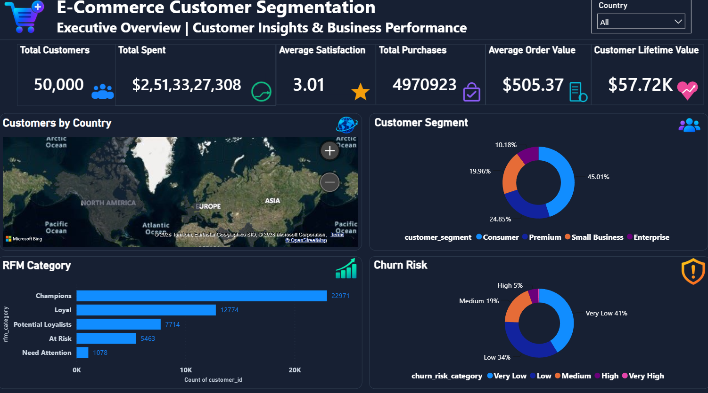

# 🛒 E-Commerce Customer Segmentation Dashboard

## 📌 Project Overview

The E-Commerce Customer Segmentation Dashboard is an interactive data analytics project developed using Microsoft Power BI. The dashboard provides an overview of customer purchasing behavior, spending patterns, satisfaction levels, and customer segmentation.

The main objective of this project is to transform customer data into meaningful business insights that can support better decision-making.

## 🎯 Project Objectives

- Analyze customer purchasing behavior.
- Understand customer spending patterns.
- Identify different customer segments.
- Analyze RFM categories.
- Monitor customer churn risk.
- Evaluate customer satisfaction and lifetime value.

## 🛠️ Tools & Technologies

- Microsoft Power BI
- DAX (Data Analysis Expressions)
- Microsoft Excel
- Data Cleaning and Transformation
- Data Visualization

## 📊 Dashboard Features

### Executive Overview

The dashboard includes the following key performance indicators (KPIs):

- Total Customers
- Total Spent
- Total Purchases
- Average Order Value
- Average Satisfaction
- Customer Lifetime Value

### Data Analysis & Visualizations

- **Customers by Country:** Geographical distribution of customers.
- **Customer Segment:** Distribution of customers across segments.
- **RFM Category:** Customer analysis based on Recency, Frequency, and Monetary categories.
- **Churn Risk:** Visualization of customer churn risk categories.
- **Country Filter:** Interactive filtering based on customer country.

## 💡 Business Value

This dashboard helps businesses understand customer behavior, identify valuable customer groups, monitor potential churn risks, and make data-driven decisions to improve customer engagement and retention.

## 🖥️ Dashboard Preview

## 📁 Project Files

- Power BI Dashboard (.pbix)
- Excel Dataset (.xlsx)
- Dashboard Preview (.png)
- Project Demonstration Video (.mp4)

⭐ If you find this project useful, feel free to explore the repository!
